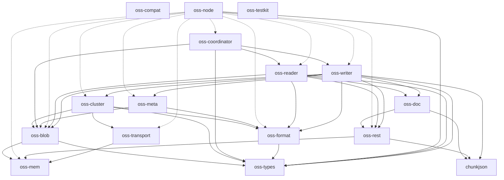

# Architecture

A stateless search service on object storage. Nodes hold caches, never durable state: the object store (S3, RustFS in tests, or a directory for a single-host node) is the only durable tier, for data and metadata. The blob formats are shared with the Java serverless shell so both can run against the same bucket during the migration.

## Crate map

Dependencies point downward only (`scripts/check-layering.py`): `oss-types`, `oss-mem`, `oss-testkit` (layer 0) ← `oss-blob`, `oss-format`, `oss-rest`, `oss-transport` (1, siblings) ← `oss-meta`, `oss-cluster`, `oss-doc` (2, siblings) ← `oss-reader`, `oss-writer` (3, siblings that never depend on each other) ← `oss-coordinator` (4) ← `oss-node` (5) ← `oss-compat` (6). The graph below is generated from `cargo metadata` by `scripts/gen-crate-map.py`; dashed edges are optional (a role behind its Cargo feature). CI fails when it is stale.

<!-- crate-map:start -->

<!-- crate-map:end -->

lucene-rust, the engine and the only sibling project used as code, comes in below the role crates as pinned git crates ([ADR 0002](adr/0002-runtime-dependencies.md)).

| Crate | Owns | README |
|---|---|---|
| `oss-types` | identifiers, value types | [crates/types](../crates/types/README.md) |
| `oss-mem` | memory budget, pools, buffer pool | [crates/mem](../crates/mem/README.md) |
| `oss-testkit` | test-only: counting allocator, peak-memory assertions | [crates/testkit](../crates/testkit/README.md) |
| `oss-blob` | S3 request kinds, the meter, the store | [crates/blob](../crates/blob/README.md) |
| `oss-format` | the Java shell's blob formats (segment blobs, node packs, commit descriptors) | [crates/format](../crates/format/README.md) |
| `oss-rest` | HTTP server, streaming bodies, routing | [crates/rest](../crates/rest/README.md) |
| `oss-meta` | names, index descriptors and tombstones on registers | [crates/meta](../crates/meta/README.md) |
| `oss-transport` | OpenSearch's native transport wire, spoken with Java nodes | [crates/transport](../crates/transport/README.md) |
| `oss-cluster` | fleet membership by node leases, placement computed from them, and document routing | [crates/cluster](../crates/cluster/README.md) |
| `oss-reader` | published-commit reads, page cache, query phase | [crates/reader](../crates/reader/README.md) |
| `oss-writer` | node write log, segment build and upload, publish | [crates/writer](../crates/writer/README.md) |
| `oss-coordinator` | REST, routing, fan-out, reduce | [crates/coordinator](../crates/coordinator/README.md) |
| `oss-node` | process wiring, role selection | [crates/node](../crates/node/README.md) |
| `oss-compat` | OpenSearch compatibility suite | [crates/compat](../crates/compat/README.md) |

## Folder layout

```
crates/<name>/            one crate per concern
  Cargo.toml              [lints] workspace = true
  README.md               Owns / Depends on / Entry points
  AGENTS.md               the crate's local rules for agents
  port-map.tsv            each source file's Java origin, or why it is new
  src/lib.rs              crate doc, module list, re-exports only
  src/<concern>.rs        one concern per file, < 500 lines
  tests/                  integration tests against the in-process emulator
docs/
  principles.md           the rules
  architecture.md         this file
  roadmap.md              what is built in which order
  invariants.md           what must never break, linked to its tests
  specs/<feature>/        SPEC.md before the code, VERIFIED.md when done
  adr/                    decisions, one file each
  how-to/                 recipes for common changes
  mechanical-gates.md     what each check catches and cannot catch
scripts/                  gate.sh, bootstrap.sh, check-*.py
.agents/skills/           agent procedures (Claude Code reads them via .claude/skills)
```

## Write flow (target design)

1. A coordinator routes a bulk request to the writer holding each shard.
2. The writer appends the records to its **node** write log: one conditional-create PUT per log slot, covering every shard on the node. The write is acknowledged when that PUT succeeds.
3. The writer pushes the records to the readers serving those shards, so they are searchable before any segment exists.
4. On refresh, the writer builds segments and uploads each as **one immutable blob**, with the commit's metadata carried inside an upload it makes anyway.
5. The writer tells readers of the new commit directly. Readers never poll for it.

## Read flow (target design)

1. A coordinator parses the query and fans it out to readers holding the shards.
2. A reader opens the latest published commit it was told about: ranged GETs into segment blobs through the page cache, located from the blob's offset header without a LIST.
3. It searches the segments plus the pushed tail records, and returns shard results.
4. The coordinator reduces shard results into the response, reporting the requests the search cost.

These flows are the contract the Java shell already implements; the Rust roles are built against it in the order in [roadmap.md](roadmap.md).
